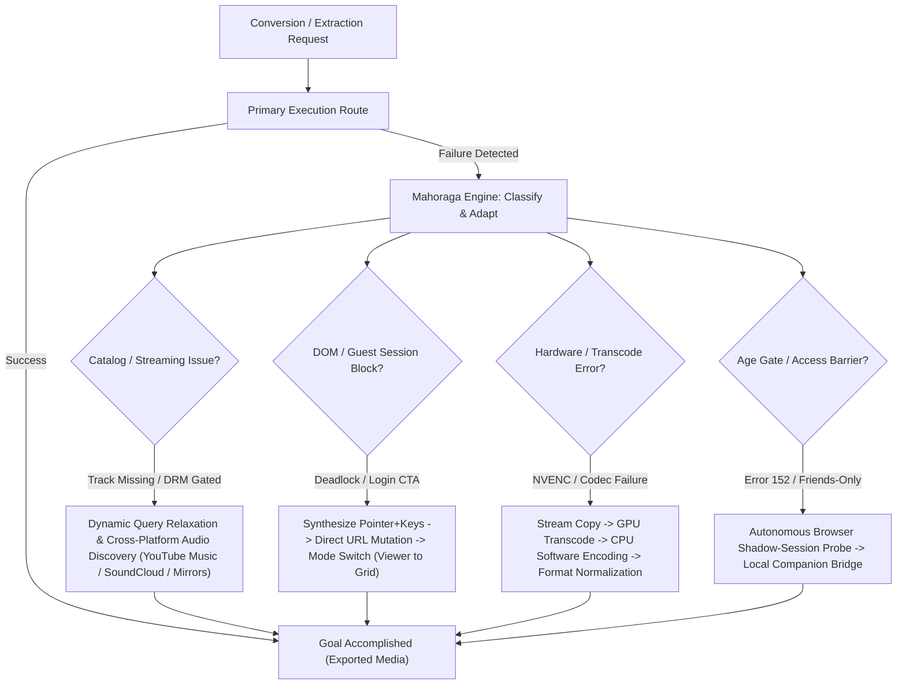

# JaneConverter

<p align="center">
  
</p>

<p align="center">
  <strong>Universal Media Downloader & High-Fidelity Audio / Video / Image Transcode Studio</strong>
</p>

<p align="center">
  
  
  
  <br />
  
  
  
</p>

> *"JaneConverter is tailored specifically for my personal needs and convenience. But I wanted to share it because it can be useful. I don't have a particular goal, it's just my personal toolbox. If you find it useful, then that's great."*  
> — **Jane Cerys**

JaneConverter is a personal media toolbox and format conversion studio designed by Jane Cerys (`project//aspyr`). Built for personal workflow convenience, high-fidelity audio engineering, video transcode tasks, and social media archival, it runs locally through a sleek Tauri desktop app or high-speed Python CLI—featuring studio-grade SoX resampling, zero-loss stream copy remuxing (`-c copy`), EBU R128 loudness normalization, and hardware-accelerated GPU encoding.

[Latest release](https://github.com/jeongchaeul/JaneConverter/releases/latest) · [Changelog](CHANGELOG.md)

## Features

- **Comprehensive Multi-Format Processing**:
  - **Audio outputs**: WAV, FLAC, MP3, AAC/M4A, OGG, Opus, AIFF, ALAC, AC3, MP2, WMA, CAF, and AU.
  - **Video outputs**: MP4, MKV, WebM, MOV, AVI, FLV, M4V, TS/M2TS, MPEG/MPG/VOB, 3GP, WMV/ASF, and GIF.
  - **Image outputs**: JPG/JPEG/JFIF, PNG, WebP, BMP, TIFF, GIF, ICO, TGA, and portable PBM/PGM/PPM (including animated GIF, APNG, and WebP preservation).
  - **Inputs**: Common audio, video, and still-image files are detected by extension and verified by magic bytes (including Multi-Picture Object / Ultra HDR JPEGs, JFIF, TIFF, AVIF, and HEIF/HEIC). The actual files a build can decode depend on its bundled FFmpeg and Pillow support.
- **Audiophile-Grade Sound Engine**: 64-bit float SoX resampler (`soxr`, precision 28, cutoff 0.99), EBU R128 loudness normalization (`-14 LUFS`), cover-art stream handling (`attached_pic` aware), and post-conversion `ffprobe` stream validation to prevent corrupt, 0-byte completions.
- **Instant Stream Copy & Bounded Recovery**: Zero-loss container conversion (`-c copy`) when underlying codecs match, paired with a bounded, policy-aware recovery engine (`stream-copy` -> `gpu-transcode` -> `cpu-transcode`, `image-pillow` -> `image-ffmpeg-frame`, cover-art normalization fallback, and optional lossless `PNG` recovery when `Preserve Quality` encounters non-standard source image encodings).
- **Adaptive GPU Acceleration**: Dedicated **Adaptive GPU Acceleration** control in Settings supporting NVIDIA NVENC, AMD AMF, Intel QSV, and Linux VAAPI. Automatically accelerates video encoding (`MP4`, `MKV`, `MOV`), bypasses the GPU for *Preserve Quality (Source)*, audio, and images so source streams stay untouched, and falls back to multi-core CPU encoding when a codec is unsupported by hardware.
- **Drag-and-Drop, Batch Queue & Completion Summary**: Drag local media files or web links directly into the converter. Dropping multiple files populates the sequential batch queue with live per-item progress, **Pause / Resume** and **Abort** operation controls, and host taskbar attention/glow notifications upon completion or failure, followed by a completion summary modal with output format/quality details, elapsed time, fallback notes, and one-click **Play / Open file** and **Open folder** actions.
- **Converted Library & Conversion History**: Browse exports across **Explorer**, **Recent**, and **Conversion History** tabs with **All**, **Audios**, **Videos**, **Images**, and **Metadata** filters, thumbnail and cover-art previews, per-item conversion duration badges, and native file drag-and-drop into external applications.
- **1-Click Intent Presets**: Goal-oriented presets grouped under Audio, Video, and Image tabs, including *Preserve Quality (raw stream without re-encoding)*, *Studio Master (32-bit WAV)*, *Universal Music (320k MP3)*, *Lossless FLAC (24-bit)*, *Universal Video (1080p MP4)*, *Studio Cinematic (Original MKV)*, and *Lossless Image (PNG)*. Clicking an active preset again clears it, and the **Advanced settings** switch unlocks manual parameter customization.
- **Online Extraction & Smart Social Routing**: yt-dlp-powered media extraction (with bundled `yt-dlp-ejs`), native modal playlist track selection, public Spotify and Apple Music catalog matching with the Mahoraga Fallback Engine, parallel fragment downloading, and automatic handoff from social photo capture to the video conversion pipeline when a link points to a Reel or video post.
- **Autonomous Multi-Browser Session Probing & Sandboxed Recovery**: Public, unauthenticated extraction is always attempted first. When a media platform enforces a sign-in wall, age-gate (e.g. YouTube Error 152), or friends-only/members-only restriction (Facebook Reels, Instagram, TikTok), the engine autonomously probes installed desktop browser profiles (Vivaldi, Chrome, Edge, Brave). To ensure complete user security, session cookies are read through non-locking shadow copies into volatile process memory only: unrelated site cookies are stripped, passwords are never touched, zero cookie files are ever written to disk, and the in-memory cookie jar is instantly purged upon completion.
- **Air-Gapped Browser Bridge (Last Resort Companion)**: An optional local companion extension to capture active media (**Capture current media**, **Collect mode**, **Network Compatibility Mode**, and adaptive **Story sequence** capture) directly from browser tabs when direct engine extraction is blocked by heavy DRM or interactive web players. Communicates exclusively over a local authenticated loopback token (`127.0.0.1`).
- **Signed In-App Updates**: Cryptographically signed desktop update packages via the rolling `continuous` release feed and tagged releases, with automatic GitHub Atom feed fallback when unauthenticated API requests are rate-limited.
- **FL Studio (.flp) Project Downgrade (Experimental)**: Native project header inspector and surgical binary patcher designed for music producers collaborating across different FL Studio versions. Inspects project tempo (BPM), PPQ timebase, channel count, and build numbers, auto-detects locally installed FL Studio versions on Windows, and patches Event 0xC7 / 0x9F version and build identifiers.

## The Mahoraga Fallback Engine (Adaptive Architecture)

JaneConverter's core engineering philosophy is anchored in the **Mahoraga Engine**—an adaptive resilience framework inspired by Mahoraga's adaptation ability from *Jujutsu Kaisen*. When encountering an obstacle, resistance, or unexpected failure, it does not simply break; it analyzes the challenge, learns from the roadblock, and continuously discovers alternative routes until its objective is achieved.

In JaneConverter, this adaptation logic governs every media processing and extraction pipeline. Instead of failing immediately when a stream is blocked, an audio source is unavailable, or a platform alters its layout, the engine dynamically reroutes around points of failure:



### Key Pillars of the Mahoraga Adaptation Logic

1. **Cross-Platform Audio Recovery (Spotify & Apple Music)**:
   - When converting streaming playlists or individual tracks from catalog platforms (which do not serve unprotected raw audio bytes), the engine extracts authoritative catalog metadata (title, artist, album, duration, ISRC) and initiates an adaptive cross-platform audio search.
   - If an audio source becomes unavailable, region-locked, or mismatched on one provider (e.g. Spotify), the engine adapts by querying alternative high-fidelity public sources (YouTube Music, SoundCloud, artist topic channels) with relaxed syntax matching, ensuring playlist conversions complete even when individual sources drop.

2. **Autonomous DOM & Guest Navigation Adaptation (Facebook, Instagram, TikTok)**:
   - In guest-mode social media archival, platform layouts and dynamic React buttons frequently drop clicks or trigger pop-up barriers.
   - The engine adapts through multi-tiered navigation: synthesizing pointer and keyboard navigation events, auto-dismissing non-standard login callouts, breaking deadlocks by direct URL parameter mutation, and seamlessly switching extraction paradigms (e.g. falling back from individual photo viewer mode to whole-album grid mode).

3. **Multi-Tiered Transcode & Encoding Resilience**:
   - Conversions dynamically progress through bounded recovery stages: zero-loss stream copy (`-c copy`) -> hardware-accelerated GPU transcoding (NVENC, AMF, QSV) -> multi-core CPU software encoding -> container format normalization.
   - Local conversion successes and failure categories are recorded into local recovery evidence (`recovery-evidence.json`), allowing the engine to learn which methods successfully resolve specific container or encoder quirks.

4. **Multi-Browser Session Self-Healing**:
   - When encountering age restrictions (YouTube Error 152) or private/friends-only posts, the engine autonomously probes active desktop browsers (Vivaldi, Chrome, Edge, Brave) using ephemeral, air-gapped memory probes, bypassing authentication barriers without requiring user credential configuration.

## Platform Coverage and Verification

### Verified Working — Media Catcher

- **Instagram**:
  - IG Single Photo
  - IG Multiple Photo
  - IG Reel
- **Facebook**:
  - FB Single Photo
  - FB Multiple Photo
  - FB Group Post
  - FB Reel
- **TikTok**:
  - TT Photo
  - TT Multiple Photos
  - TT Videos

### Primary Audio Converter

- **SoundCloud, Spotify, YouTube**: Verified working with direct extraction and catalog metadata resolution.
- **Apple Music**: Dual-mode extraction. When logged in through a desktop browser, direct audio streams can be read via browser session recovery. When logged out or unauthenticated, the **Mahoraga Fallback Engine** automatically identifies the track metadata and discovers matching high-fidelity audio sources across alternative platforms (YouTube Music, Spotify, catalog databases). The Browser Bridge extension remains available as an interactive capture fallback.

### Story Grabber

- **Requires the Browser Extension** (`JaneConverter Browser Bridge`).
- *Note*: Stories are notoriously difficult to catch and can break when platforms change their layout or player behavior. The Story Grabber includes an adaptive learning layer and will continue to be updated and refined over the coming months and years to adapt as platforms evolve.

### Additional Code Paths & Coverage Summary

| Platform or workflow | Implemented path | Verification status |
| --- | --- | --- |
| Instagram (`Single Photo`, `Multiple Photo`, `Reel`) | Hidden guest-page capture + video handoff + browser session fallback | **Verified working** |
| Facebook (`Single Photo`, `Multiple Photo`, `Group Post`, `Reel`) | Hidden guest-page capture + video handoff + browser session fallback | **Verified working** |
| TikTok (`Photo`, `Multiple Photos`, `Videos`) | Hidden guest-page capture + yt-dlp extraction + browser session fallback | **Verified working** |
| YouTube, SoundCloud, Spotify | yt-dlp media extraction + public catalog metadata matching | **Verified working** |
| Apple Music | Dual-mode: Browser session / Mahoraga Fallback Engine + Browser Bridge | **Verified working** (Catalog discovery + public source fallback; Browser Bridge available for active tab capture) |
| Story Grabber | Browser Bridge (`Capture current media`, `Collect mode`, `Story sequence`) | Requires the **Browser Extension** (subject to platform layout changes; actively maintained with adaptive updates) |
| X/Twitter post photos, Reddit galleries, Tumblr photo posts, Pinterest Pins/boards/sections | Hidden guest-page capture | Code paths and automated checks are present; not part of the verified set above |
| Snapchat Public Stories | None | Not implemented; guest access in a desktop browser has not been verified |

Social photo and video extraction prioritizes public access first. If a post is private, friends-only, or sign-in gated, JaneConverter can autonomously use your active desktop browser session when **Session Recovery** is enabled in Settings (or the Browser Bridge extension as an interactive companion) to recover the media.

## Supported Formats

### Selectable output formats

These are the output targets configured in the app. Every source/target codec combination has not been validated end to end.

| Media type | Selectable output formats |
| --- | --- |
| Audio | MP3, FLAC, WAV, AAC, OGG, M4A, Opus, AIFF, AIF, ALAC, AC3, MP2, WMA, CAF, AU |
| Video | MP4, MKV, WebM, MOV, GIF, AVI, FLV, M4V, TS, M2TS, MPEG, MPG, VOB, 3GP, WMV, ASF |
| Images | JPG, JPEG, JFIF, PNG, WebP, BMP, TIF, TIFF, GIF, ICO, TGA, PPM, PGM, PBM |

ALAC files use the `.m4a` extension. Video output size can be set to original, 4K, 1440p, 1080p, 720p, or 480p when the source provides a suitable stream.

### Recognized local input extensions

These extensions are recognized when adding local files. Decoding depends on the file's actual encoding and the bundled FFmpeg and Pillow support.

- **Audio:** `.mp3`, `.flac`, `.wav`, `.aac`, `.ogg`, `.m4a`, `.opus`, `.aiff`, `.aif`, `.alac`, `.ac3`, `.mp2`, `.wma`, `.caf`, `.au`, `.oga`, `.m4b`, `.m4p`, `.ape`, `.aifc`, `.amr`, `.dts`, `.mka`, `.mpc`, `.ra`, `.ram`, `.tta`, `.voc`, `.wv`, `.wvc`, `.8svx`, `.3ga`
- **Video:** `.mp4`, `.mkv`, `.webm`, `.mov`, `.gif`, `.avi`, `.flv`, `.m4v`, `.ts`, `.m2ts`, `.mpeg`, `.mpg`, `.vob`, `.3gp`, `.wmv`, `.asf`, `.3g2`, `.asx`, `.avchd`, `.divx`, `.dv`, `.f4v`, `.m2v`, `.mjpg`, `.mjpeg`, `.mts`, `.mxf`, `.ogv`, `.qt`, `.rm`, `.rmvb`, `.yuv`
- **Images:** `.jpg`, `.jpeg`, `.jfif`, `.png`, `.webp`, `.bmp`, `.tif`, `.tiff`, `.gif`, `.ico`, `.tga`, `.ppm`, `.pgm`, `.pbm`, `.apng`, `.avif`, `.cur`, `.dib`, `.emf`, `.eps`, `.exr`, `.heic`, `.heif`, `.icns`, `.j2k`, `.jp2`, `.jpe`, `.jfi`, `.jif`, `.jxl`, `.pcx`, `.pfm`, `.pic`, `.psd`, `.ras`, `.sgi`, `.svg`, `.xbm`, `.xpm`, `.qoi`

## Install

Download the matching artifact from the [latest release](https://github.com/jeongchaeul/JaneConverter/releases/latest):

- Windows x64 installer (supports signed in-app updates): `JaneConverter-<version>-windows-x64-setup.exe`
- Windows x64 portable: `JaneConverter-<version>-windows-x64-portable.zip`
- Linux x86_64 AppImage (supports signed in-app updates): `JaneConverter-<version>-linux-x86_64.AppImage`
- Linux x86_64 portable: `JaneConverter-<version>-linux-x86_64.tar.gz`
- macOS Apple Silicon (supports signed in-app updates): `JaneConverter-<version>-macos-arm64.dmg`
- macOS Intel (supports signed in-app updates): `JaneConverter-<version>-macos-x86_64.dmg`

Python, FFmpeg, FFprobe, and Node.js are bundled. Windows requires WebView2. Linux requires WebKitGTK 4.1 and standard GTK desktop libraries. macOS builds are architecture-specific, not universal binaries.

Each artifact includes a `.sha256` checksum. Verify it with `Get-FileHash <file> -Algorithm SHA256` on Windows, `sha256sum -c <file>.sha256` on Linux, or `shasum -a 256 -c <file>.sha256` on macOS.

Launch `JaneConverter.exe` on Windows or `./JaneConverter/JaneConverter` from the extracted Linux archive. On macOS, open the DMG and drag JaneConverter to Applications.

The macOS app is only ad-hoc signed, and the DMGs are not Developer ID signed or notarized. Gatekeeper may block the first launch. In Finder, Control-click JaneConverter, choose **Open**, then confirm **Open**. Only bypass the warning after verifying the checksum and release source.

Application data is stored in the OS user-data directory (`%APPDATA%\JaneConverter` on Windows, with automatic migration from legacy `%LOCALAPPDATA%` installs). You can relocate the data root in **Settings** > **Application data folder** or set `JANECONVERTER_DATA_DIR` to override it.

## Usage

Paste a supported URL or choose a local file (or drag and drop files / links directly into the source box), select your desired output settings or 1-click preset, then start the conversion. The desktop app includes playlist selection, a sequential batch queue, a converted-library browser (**Explorer**, **Recent**, and **Conversion History**), a hardware & pipeline monitor, custom theme and accent colors, live logs, diagnostics, and **Pause / Resume** and **Abort** controls in both the Converter and Console views.

### Public Facebook photo posts

Paste a public Facebook post or Group permalink link and click **Convert media**. JaneConverter reads the post in a separate, hidden temporary guest WebView, dismisses login-wall overlays, resolves both standard post albums (`set=pcb.<post_id>`) and Facebook Group photo sets (`set=gm.<media_id>`), collects the photo URLs Facebook renders for logged-out visitors, then passes that short-lived list directly to the local engine. Photos are validated by image bytes and saved in a grouped folder under `Images/Facebook`, where the library lists image files alongside audio and video. If a post is video-only or the user selected a Video preset, JaneConverter automatically hands the URL off to the video conversion pipeline. By default, public guest capture runs in a temporary, sandboxed guest session without accessing your normal browser profile, stored login cookies, browser extensions, or remote download services. The temporary profile is removed after capture. Posts that require sign-in or friends-only access will prompt you to enable **Session Recovery** in Settings or capture via the Browser Bridge extension.

### Public Instagram, TikTok, and X/Twitter photo posts

Paste a public Instagram post/Reel (`/{username}/p/{shortcode}/`, `/p/{shortcode}/`, `/{username}/reel/{shortcode}/`, or `/reel/{shortcode}/`), TikTok photo/video link, or X/Twitter post link and click **Convert media**. JaneConverter uses a separate, hidden temporary guest WebView to collect the photos the post exposes to logged-out visitors, filtering out comment stickers/GIFs and footer post grids while preserving multi-photo carousel `<ul>` slide tracks. Downloaded images (including two-frame Multi-Picture Object / Ultra HDR JPEGs) are validated by magic bytes and saved into grouped folders under `Images/Instagram`, `Images/TikTok`, or `Images/Twitter`. Posts or Reels that contain video instead of photos automatically switch to the video conversion pipeline. By default, guest capture operates cleanly without accessing your normal browser profile, saved login cookies, browser extensions, or remote download services.

### Other public photo collections

The one-link capture flow also includes code paths for Reddit image galleries, Tumblr photo posts, and Pinterest Pins, boards, and sections. Pinterest boards are scanned as a collection, while post carousels and gallery viewers are advanced in sequence. Captures are limited to image URLs rendered by the public page and validated against that platform's image CDN; incomplete captures are not saved. Secret/private boards and posts that require sign-in are stopped under default public settings. Snapchat Public Stories are not implemented because guest access through its desktop browser has not been verified.

By default, JaneConverter operates strictly in public air-gapped mode and does not read browser cookies. When an online media platform reports that a stream requires sign-in, enforces an age restriction (such as YouTube Error 152), or restricts access to friends or subscribers, JaneConverter can autonomously use your active desktop browser sessions if **Session Recovery** is enabled in **Settings** (disabled by default). See the transparent breakdown below for exactly how this informed consent model works.

### Transparent Browser Session Security & Privacy (Opt-In)

Reading session cookies is strictly **opt-in** and managed via **Settings > Read Browser Cookies (Session Recovery)** (disabled by default).

#### The Informed Consent Map: What Works vs. What Won't Work

| Mode | What Works | What Won't Work |
| :--- | :--- | :--- |
| **Disabled (Default Air-Gap Mode)**<br>*(Recommended for general public use)* | • **All public media**: 1,000+ platforms (YouTube, SoundCloud, Spotify, Reddit, Vimeo, TikTok, etc.) convert normally.<br>• **Public photo albums**: Public Facebook albums, Instagram carousels, and TikTok photos.<br>• **Local media & FLP projects**: High-fidelity audio/video/image transcoding and FL Studio project downgrading.<br>• **Browser Extension Bridge**: Active tab capture without inspecting local browser files on disk.<br>• **Zero browser file access**: Local browser SQLite databases are strictly never opened, inspected, or queried. | • **Friends-only Facebook Reels & posts**: Facebook blocks guest access with *"Sign-in required"*.<br>• **Age-gated & bot-checked YouTube videos**: Videos requiring authentication (YouTube Error 152).<br>• **Private or followers-only accounts**: Instagram private posts and subscriber-only streams.<br>• **Apple Music direct playback**: Apple Music requires sign-in for unencrypted playback (JaneConverter's Mahoraga Engine automatically falls back to alternative public catalog sources). |
| **Enabled (Session Recovery)**<br>*(For authenticated / gated media)* | • **Friends-only Facebook Reels & posts**: Automatically extracts media when you are logged into your browser.<br>• **Age-restricted YouTube & anti-bot screens**: Transparently bypasses Error 152 and login-gated videos.<br>• **Subscriber & members-only media**: Resolves streams from accounts you have authenticated sessions for.<br>• **Frictionless recovery**: Zero manual cookie export files (`.txt`) or password entry needed. | • Requires an active, logged-in session in one of your installed desktop browsers (Vivaldi, Chrome, Edge, Brave, Firefox, Opera). |

#### Air-Gapped Privacy & Security Guarantees

To be completely honest and transparent about how this works: **JaneConverter reads active browser session cookies for the specific media domain being converted**, but operates under rigorous, defense-in-depth safety constraints:

1. **Strictly Local & Air-Gapped**: The entire process occurs 100% on your machine. JaneConverter has no tracking servers, telemetry, cloud relays, or analytics. Your session data never leaves your computer.
2. **Ephemeral In-Memory Only (Zero Disk Writes)**: Cookies are read directly into temporary RAM (`RequestsCookieJar`). JaneConverter **never writes, exports, or stores cookie files** (no `.txt`, `.cookies`, or Netscape files) to your hard drive.
3. **Domain-Isolated Scoping**: Only cookies matching the target media domain (e.g. `facebook.com`, `instagram.com`, `youtube.com`) are loaded. Sensitive unrelated cookies—such as online banking, email, cloud services, and password vaults—are never touched or accessed.
4. **No Password Decryption**: JaneConverter only reads HTTP session cookies already created by your browser. It cannot access, decrypt, or read your saved account passwords.
5. **Non-Locking Shadow Copy**: Browser databases are accessed using temporary, non-locking shadow copies. Your browser remains fully open and usable during conversion, and no browser files are ever modified.
6. **Instant RAM Purge**: The moment extraction finishes (or if the job aborts or fails), the in-memory cookie jar is immediately wiped from memory.

> [!TIP]
> **Source Browser Pre-Opening**: In **Settings**, you can also enable **Source Browser Pre-Opening** (`openInBrowser`). When enabled, JaneConverter will automatically open media links in your browser before conversion starts. This warms up anti-bot verification challenges and writes fresh session cookies to your local browser profile so private, friends-only, or members-only conversions succeed seamlessly on the first attempt.
>
> **Apple Music Behavior**: For Apple Music links, direct playback streams naturally fail if you are not actively logged into an active Apple Music browser session. However, you don't need to be logged in: JaneConverter's built-in **Mahoraga Fallback Engine** automatically catches the failed stream, parses the track catalog metadata, and discovers matching high-fidelity audio sources across alternative public platforms (YouTube Music, Spotify, catalog mirrors).

For users who prefer interactive capture or encounter heavy DRM/player protections, the **Browser Extension** (`JaneConverter Browser Bridge`) remains available as an optional companion. Captured items appear in the dedicated **Media Capturer** tab and are saved in the configured media capturer folder. The default is a `fetched` folder beside the converted library; clearing access ends the browser session without deleting those files. Each item supports **Open file**, **Open path**, **Use for conversion**, and **Discard**.

### FL Studio Project (.flp) Downgrade (Experimental)

JaneConverter includes an experimental workflow for music producers and audio engineers encountering cross-version compatibility barriers in Image-Line's FL Studio.

- **Why it's there**: Music collaboration frequently involves artists working across different FL Studio versions (e.g., FL 24 vs. FL 21 vs. FL 20). When a collaborator on a newer version saves an `.flp` project, opening it on an older FL Studio installation is normally blocked by FL Studio's version check dialog. This tool was built as part of the `project//aspyr` production toolkit to explore non-destructive project header adaptation.
- **What it does**: Inspects project metadata (BPM, PPQ timebase, channel count, license status, exact version string, and DWORD build number), auto-detects locally installed FL Studio editions on Windows for 1-click targeting, and surgically patches version headers (ASCII Event `0xC7`, DWORD little-endian Event `0x9F`, and UTF-16LE version strings) while adjusting playlist clip chunk records (Event `0xD4`).
- **Current state (Experimental)**: While surgical binary patching successfully updates structural version headers without deserializing musical arrangements, modern FL Studio releases (FL 21.x, 24.x, and beyond) introduce proprietary internal event schemas, generator state chunks, and plugin wrapper formats that can still cause FL Studio to flag the file or behave unpredictably depending on project complexity and third-party VSTs. Because bit-level backward compatibility across arbitrary FL Studio versions remains an active research effort, this feature is labeled **Experimental**. **Always keep safe backups of your original `.flp` files before running experimental downgrades.**

## Browser Extension (Local Installation Guide)

The **JaneConverter Browser Bridge** is an optional companion extension that lets you capture active audio, video, and story media from browser tabs directly into the JaneConverter desktop inbox. It supports **Capture current media**, **Collect mode** (for continuous story advancing), **Network Compatibility Mode** (tab-scoped network response capture), and experimental **Story sequence** capture with 14-day local structural adaptation.

> [!NOTE]
> **Privacy First & Honest Security Architecture**:
> - **The Browser Bridge Extension**: Operates strictly within the active browser tab as an interactive media pipe. It observes media elements, streaming manifests, and media responses to stream direct URLs or raw media bytes to your local desktop app via an authenticated loopback connection (`127.0.0.1`). **The extension itself never reads your browser's cookie database, exports credentials, accesses passwords, or inspects browsing history outside the active tab.**
> - **Desktop Engine vs. Extension Scoping**: The Browser Extension is completely separate from the desktop engine's Session Recovery feature. The extension operates only inside the active tab you explicitly click. Meanwhile, the desktop engine's **Session Recovery** is an independent, opt-in feature in Settings that uses non-locking shadow copies in RAM only when converting gated URLs directly. In both cases, operations are 100% local, ephemeral in-memory, zero-telemetry, and strictly air-gapped.

Because the extension is a local power-user tool and not distributed through the Chrome Web Store or Firefox Add-ons, install it manually in **under 60 seconds**:

### Chromium-Based Browsers (Google Chrome, Microsoft Edge, Brave, Vivaldi, Opera)

1. **Locate the Extension Folder**:
   - In the JaneConverter repository or release package, locate the `browser-extension` folder.
2. **Open Extensions Page**:
   - **Google Chrome**: Navigate to `chrome://extensions`
   - **Microsoft Edge**: Navigate to `edge://extensions`
   - **Brave**: Navigate to `brave://extensions`
   - **Vivaldi**: Navigate to `vivaldi://extensions`
   - **Opera**: Navigate to `opera://extensions`
3. **Enable Developer Mode**:
   - Toggle the **Developer mode** switch (usually in the top-right corner).
4. **Load the Extension**:
   - Click the **Load unpacked** button (top-left).
   - Select the `browser-extension` folder from Step 1.
5. **Pin & Connect**:
   - Pin the JaneConverter icon to your browser extensions toolbar.
   - In the JaneConverter desktop app, click **Create access link** on the **Media Capturer** tab to generate a pairing session.
   - Confirm access in your browser, then open the extension popup from the toolbar to capture media straight to your desktop queue.

## Command line

Source use requires [uv](https://docs.astral.sh/uv/), Python 3.10+, FFmpeg with FFprobe, and Node.js:

```bash
uv sync
uv run janeconverter --source "https://example.com/media" --format mp3

# FL Studio project inspection & experimental downgrade
uv run janeconverter --flp-inspect "project.flp"
uv run janeconverter --flp-downgrade "project.flp" --flp-target 21.2.3 --flp-build 4004
uv run janeconverter --flp-detect-installed

uv run janeconverter --help
```

## Development

Desktop development also requires Rust, npm, and the [Tauri 2 prerequisites](https://v2.tauri.app/start/prerequisites/).

```bash
cd desktop-ui
npm ci
npm run tauri:dev
```

Run the test suites:

```bash
uv sync --locked
uv run pytest tests/ -v
cd desktop-ui
npm test -- --run
cargo test --manifest-path src-tauri/Cargo.toml
```

The Python backend uses the `src/janeconverter/` package. Its supported entry point is the `janeconverter` console command.

## Release builds

`src/janeconverter/version.py` is the canonical application version. Set it and synchronize all desktop metadata with one command:

```bash
uv run --locked python packaging/set_version.py 2.2.7
```

Run the command without a version to resynchronize from the canonical value, or pass `--check` to verify metadata without writing. The optional Browser Bridge is independently versioned and is not changed by this tool.

Consumer builds bundle the frozen `JaneConverterEngine` (`onedir` with `yt-dlp-ejs`), `FFMPEG-BUILD-INFO.txt`, and `FFMPEG-SOURCE-INFO.txt`, and run `packaging/smoke_test_engine.py` to verify local audio/video/image conversion before packaging.

Windows x64:

```powershell
.\packaging\build_consumer.ps1 -FFmpegPath C:\tools\ffmpeg.exe -FFprobePath C:\tools\ffprobe.exe -NodePath C:\tools\node.exe
```

Linux x86_64:

```bash
./packaging/build_linux.sh --ffmpeg /opt/ffmpeg/ffmpeg --ffprobe /opt/ffmpeg/ffprobe --node /opt/node/bin/node
```

macOS arm64 or x86_64 must be built natively on the matching architecture. Install Xcode Command Line Tools, Rust, uv, Python 3.12, and Node.js 22, then provide matching-architecture FFmpeg and FFprobe executables:

```bash
./packaging/build_macos.sh --ffmpeg /opt/ffmpeg/ffmpeg --ffprobe /opt/ffmpeg/ffprobe --node "$(command -v node)"
```

Tagged `v*` releases and rolling `continuous` updater feeds are built and published by GitHub Actions with pinned FFmpeg asset SHA-256 digests. The release workflow uses GPL FFmpeg builds, so distributors must preserve the required notices and satisfy the corresponding source obligations.

## About & Legal Governance

JaneConverter is an independent personal media toolbox developed by Jane Cerys (`project//aspyr`), tailored specifically for personal workflow convenience, and shared freely with the open-source community under the MIT License without commercial motives or corporate agendas.

- [Legal Disclaimer & Acceptable Use Policy](DISCLAIMER.md)
- [Security Policy & Vulnerability Reporting](SECURITY.md)
- [Third-Party Software Notices & Licenses](packaging/THIRD-PARTY-NOTICES.md)
- [Contributing Guidelines & DCO](CONTRIBUTING.md)
- [Code of Conduct](CODE_OF_CONDUCT.md)
- [MIT License](LICENSE)

Copyright © 2026 project//aspyr. All third-party trademarks belong to their respective holders and are referenced for identification and interoperability purposes only.
