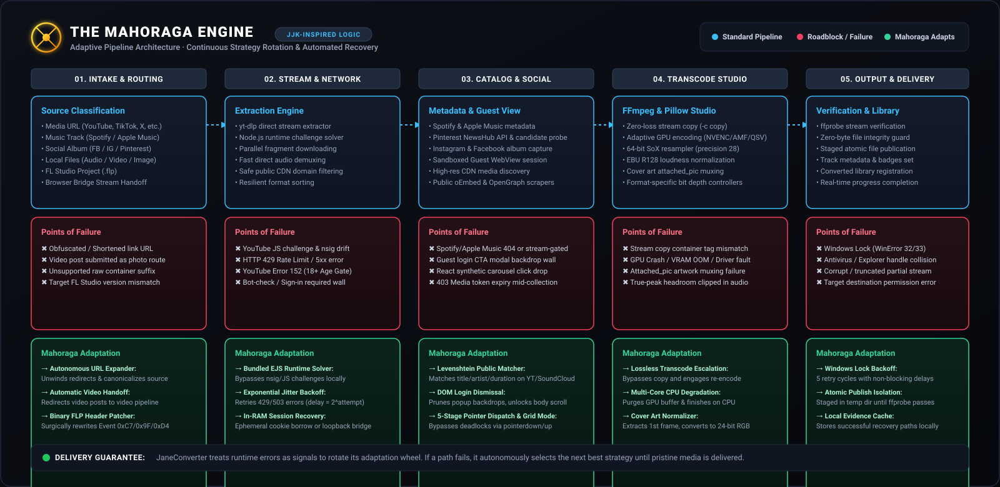

# The Adaptive Resilience Engine

*Multi-Tiered Automated Recovery, Dynamic Extraction Fallbacks, and Stream Healing*  
*(Architecture Codename: Mahoraga)*

JaneConverter's **Adaptive Resilience Engine** operates on a central principle:

**When media extraction, network transport, authentication barriers, DOM obfuscation, or hardware transcoding face resistance or failure, JaneConverter does not abort; it analyzes the roadblock, rotates strategy, and adapts until pristine media is delivered.**

---

## Table of Contents

1. [Architecture Motivation](#1-architecture-motivation)
2. [Pipeline Architecture](#2-pipeline-architecture)
3. [The 6 Pillars of Adaptive Resilience](#3-the-6-pillars-of-adaptive-resilience)
   - [Pillar 1: Stream Extraction & Network Adaptation](#pillar-1-stream-extraction--network-adaptation)
   - [Pillar 2: Authenticated Session Adaptation & DPAPI Recovery](#pillar-2-authenticated-session-adaptation--dpapi-recovery)
   - [Pillar 3: Cross-Platform Streaming Catalog Resolution](#pillar-3-cross-platform-streaming-catalog-resolution)
   - [Pillar 4: Autonomous DOM Scraping & Guest UI Traversal](#pillar-4-autonomous-dom-scraping--guest-ui-traversal)
   - [Pillar 5: Multi-Tiered Transcode & Hardware Resilience](#pillar-5-multi-tiered-transcode--hardware-resilience)
   - [Pillar 6: OS Resiliency & Self-Learning Evidence](#pillar-6-os-resiliency--self-learning-evidence)
4. [Case Study: Pinterest Notification Collections (`news_hub`)](#4-case-study-pinterest-notification-collections-news_hub)
5. [Engineering Tenets for Adding Adaptations](#5-engineering-tenets-for-adding-adaptations)

---

## 1. Architecture Motivation

Web media ingestion and local format transcoding operate in an inherently volatile environment:
- **Anti-Bot Systems:** Streaming platforms deploy obfuscated JavaScript challenges and changing signature algorithms (`nsig`).
- **Walled Gardens:** Social platforms redirect unauthenticated visitors from notifications to homepage feeds or low-resolution thumbnails.
- **Client Encryption Shifts:** Chromium 127+ locks DPAPI cookie extraction on Windows using App-Bound Encryption.
- **DOM Obfuscation:** React/Vue SPAs swallow bare DOM `.click()` events and dynamic carousels.
- **Hardware Instability:** Dedicated GPU encoders (NVENC, AMF, QSV) encounter VRAM exhaustion or driver limitations.
- **Host File Contention:** Windows Search indexers and antivirus scanners briefly lock output files (`WinError 32/33 PermissionError`).

The Adaptive Resilience Engine treats runtime errors as deterministic signals to pivot strategies rather than fatal termination points.

---

## 2. Pipeline Architecture

<p align="center">
  
</p>

---

## 3. The 6 Pillars of Adaptive Resilience

### Pillar 1: Stream Extraction & Network Adaptation
*Modules: `src/janeconverter/extraction_recovery.py`, `src/janeconverter/extractor.py`*

1. **JavaScript & Signature Solver Adaptation (`ExtractionCategory.LAYOUT`):** Resets internal extractor state, attaches bundled Node.js runtimes, activates `yt-dlp-ejs`, and triggers external signature solvers.
2. **Universal Format Selector Cascades (`ExtractionCategory.FORMAT`):** Cascades from strict selectors (e.g. `bestvideo[height<=1080]+bestaudio`) down to `bv*+ba/b/best` before failing.
3. **Bounded Jittered Backoff (`ExtractionCategory.RATE_LIMIT`, `NETWORK`):** HTTP 429/502/503/504 errors trigger exponential backoff with random jitter ($2^{\text{attempt}} \pm \text{random}$), bounded to a 45-second deadline.
4. **Host Permutation & Direct Scraping (TikTok):** Rotates regional API endpoints (`api16-normal`, `api22-normal`) and falls back to `_fetch_tiktok_direct()` to extract stream candidates directly from page HTML.

---

### Pillar 2: Authenticated Session Adaptation & DPAPI Recovery
*Modules: `src/janeconverter/social_photo_capture.py`, `src/janeconverter/auth.py`, `src/janeconverter/cookie_unlocker.py`*

1. **Guest-First Policy:** Operates in 100% anonymous guest mode by default without touching local browser profiles.
2. **Ephemeral Session Recovery:** For authenticated or age-gated links (YouTube Error 152, friends-only posts), makes an isolated non-locking shadow copy of the browser SQLite database. Decrypted cookies exist in an ephemeral `RequestsCookieJar` and are discarded immediately upon completion.
3. **Chromium App-Bound Encryption Negotiation:** Negotiates with browsers using standard DPAPI (Vivaldi, Firefox, Brave, Edge), discovering active sessions automatically.
4. **Loopback Browser Bridge Fallback:** Falls back to the authenticated loopback Browser Bridge (`127.0.0.1`) when local storage access is restricted.

---

### Pillar 3: Cross-Platform Streaming Catalog Resolution
*Modules: `src/janeconverter/extractor.py`, `src/janeconverter/catalog.py`*

1. **Metadata Resolution:** Ingests Spotify and Apple Music metadata via oEmbed, OpenGraph, and the iTunes Search API.
2. **Query Permutation:** Cleans titles of release clutter (`(feat. ...)`, `(Remastered)`, etc.) to create prioritized search queries.
3. **Multi-Source Probing:** Probes YouTube Music (`ytsearch5:`) and SoundCloud (`scsearch5:`) in parallel.
4. **Verification (`choose_catalog_match`):** Validates candidates via Levenshtein string distance, artist token inclusion, and a **strict ±15-second duration variance filter** to eliminate live takes, covers, and sped-up edits. Downloaded audio is tagged with canonical metadata and 1400×1400+ artwork.

---

### Pillar 4: Autonomous DOM Scraping & Guest UI Traversal
*Modules: `desktop-ui/src-tauri/src/social_photo_capture.rs`, `desktop-ui/src-tauri/src/facebook_capture.rs`*

1. **Modal & Backdrop Dismissal:** Programmatically detects and prunes login overlays and restores body scrolling.
2. **5-Stage Pointer Event Synthesis:** Executes full W3C pointer sequences:
   $$\text{pointerdown} \longrightarrow \text{mousedown} \longrightarrow \text{pointerup} \longrightarrow \text{mouseup} \longrightarrow \text{click}$$
   combined with `KeyboardEvent("ArrowRight")` to navigate dynamic React carousels.
3. **Autonomous Mode Switching:** If carousel view redirects to `/login` midway through an album, switches to album grid mode (`/media/set/?set=pcb...`) to capture remaining photos via thumbnail modals.
4. **Token Refresh on CDN 403:** Refreshes alternate CDN endpoints (`fbcdn.net`, `fbsbx.com`) if image links return HTTP 403 Forbidden.

---

### Pillar 5: Multi-Tiered Transcode & Hardware Resilience
*Modules: `src/janeconverter/converter.py`, `src/janeconverter/image_format.py`*

1. **Stream Copy Tier (`-c copy`):** Remuxes directly at the container level in milliseconds when codecs match and no filters are applied.
2. **GPU Acceleration Tier:** Leverages NVENC, AMF, QSV, or VideoToolbox ASICs for high-speed hardware encoding.
3. **Graceful CPU Degradation:** If GPU encoding fails (CUDA OOM, driver crashes), purges the staging buffer and seamlessly falls back to multi-core CPU software encoding (`libx264`, `libx265`, `svtav1`).
4. **Artwork Normalization (`cover-normalized`):** Fixes incompatible cover art (CMYK, animated GIFs) by normalizing images to static RGB PNGs via Pillow before FFmpeg muxing.
5. **Dynamic Loudness Limiter:** Automatically engages two-pass `loudnorm` limiting if linear EBU R128 gain adjustment would exceed `-1.0 dBTP`.
6. **FFmpeg Master Frame Extraction:** Decodes rare image formats (HEIF, AVIF, animated WebP, PSD, QOI) into uncompressed frames using FFmpeg before Pillow processing.

---

### Pillar 6: OS Resiliency & Self-Learning Evidence
*Modules: `src/janeconverter/converter.py`*

1. **Atomic File Staging:** Conversions process in an isolated staging folder (`temp/job_<id>/`) and move to output directories only after passing stream validation.
2. **Stream Validation:** Probes completed media with `ffprobe` to verify container headers and stream continuity.
3. **Windows File Lock Recovery:** Bounded exponential backoff ($0.1\text{s} \times 2^{\text{attempt}}$) across 5 attempts to bypass transient Windows Search / Antivirus file locks (`WinError 32/33`).
4. **Persistent Adaptation Memory:** Successful recovery strategies are saved to:
   ```text
   %APPDATA%/JaneConverter/recovery-evidence.json
   ```
   allowing subsequent runs to select optimal strategies on the first attempt.

---

## 4. Case Study: Pinterest Notification Collections (`news_hub`)

When a user submits a Pinterest notification collection (`ph.pinterest.com/news_hub/...`):
1. **Route Recognition:** Frontend identifies the `/news_hub/` path and routes it to the session adapter.
2. **Browser Negotiation:** Engine discovers active, DPAPI-readable sessions in Vivaldi containing Pinterest authentication cookies.
3. **API Interception:** Queries Pinterest's internal `NewsHubDetailsResource` endpoint directly rather than scraping dynamic DOM.
4. **Resolution Upgrade:** Ingests all 15 nodes, rewrites thumbnail CDN paths (`/150x150/`, `/236x/`) to `/originals/`.
5. **Parallel Download:** Concurrently downloads 15 uncompressed originals (1440×1440) in ~5 seconds as lossless PNGs.

---

## 5. Engineering Tenets for Adding Adaptations

1. **Never Fail Fast on Expected Volatility:** External sites and hardware encoders fail frequently; always implement deterministic fallback paths.
2. **Classify Errors Structurally:** Route errors through structured enum classifiers (`ExtractionCategory`, `FailureCategory`) rather than generic exception blocks.
3. **Preserve Maximum Quality:** Fallbacks must maintain original resolution, audio sample rates, and bit-depths. Prioritize `/originals/` CDN mirrors over downscaled assets.
4. **Zero Persistent Secrets:** Keep borrowed session tokens strictly in memory during active jobs. Never write session tokens to persistent configuration files or logs.
5. **Record Evidence to Adaptation Memory:** Save winning strategies to adaptation memory so subsequent jobs execute the optimal strategy immediately.
